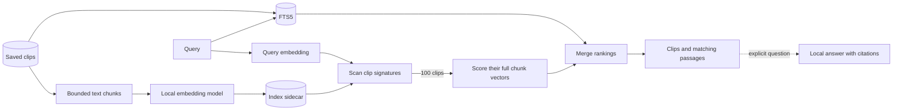
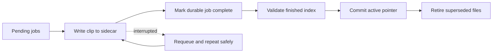

# Meaning Search and Recall

| Tool           | What it does                                                        | Needs a model?         |
| -------------- | ------------------------------------------------------------------- | ---------------------- |
| Keyword search | Finds words, prefixes, identifiers, paths, and code using FTS5      | No                     |
| Meaning Search | Finds related wording using text embeddings                         | Local embedding model  |
| Recall         | Answers an explicit question using retrieved passages and citations | Local generation model |

An **embedding** is a list of numbers representing text meaning. Similar vectors
suggest related text. A **generation model** writes an answer. An **index
generation** is a version of the search index, not an AI-written answer.
A **sidecar** is a separate, rebuildable database file beside the main database.

Original clips remain usable if models or indexes fail. Capture never waits for
embeddings. The 60,000-clip capacity target still requires installed-platform
qualification; it is not a certified product claim.

While search results refresh, the search bar shows a fading blue-to-violet beam
following its rounded border. The previous results remain visible and temporarily
inert until replacement succeeds. The beam stops on completion or failure;
reduced-motion preferences replace its movement with a static border.

## Data flow



| Storage                               | Owns                                                         | Why                                             |
| ------------------------------------- | ------------------------------------------------------------ | ----------------------------------------------- |
| `clips.db`                            | Clips, FTS, model-space identity, jobs, active-index pointer | Canonical eligibility and durable coordination  |
| `search-index/generation-{id}.sqlite` | Chunks, snippets, provenance, vectors, routing signatures    | Disposable search payload; independent recovery |

A model space fixes provider/model revision, dimensions, normalization, distance
metric, and chunking compatibility. Vectors from different spaces never mix.

## Index construction

Inputs: notes, tags, every ready text representation, and completed OCR.
Equivalent visible text is embedded once, preferring the richest safely parsed
source; distinct representations remain searchable.

| Format           | Chunk boundaries / extra context used only for embedding                            |
| ---------------- | ----------------------------------------------------------------------------------- |
| HTML / Markdown  | Headings, paragraphs, lists, quotes, code, table rows; heading ancestry and headers |
| JSON             | Object subtrees, array ranges; JSON Pointer paths                                   |
| CSV / TSV        | Whole rows with repeated headers                                                    |
| RTF              | Safely extracted paragraphs; reject unsafe control content                          |
| Code             | Declarations and blank lines; inferred language                                     |
| OCR / plain text | Paragraphs, lines, Unicode-safe windows                                             |
| Notes / tags     | Separate labelled chunks                                                            |

| Budget                    | Limit                                                                 |
| ------------------------- | --------------------------------------------------------------------- |
| Packing target            | 1,536 UTF-8 bytes                                                     |
| Final embedding input     | 2,048 bytes                                                           |
| Structural context        | 384 bytes                                                             |
| Oversized-atom overlap    | At most 256 bytes                                                     |
| Chunks per clip           | 64                                                                    |
| Reserved note/tag chunks  | Up to 8                                                               |
| Truncated clip            | Sample across content; reserve final slot for bounded routing summary |
| Provider context overflow | Subdivide only that chunk; bounded retries                            |

Hash complete enriched inputs and embed duplicates once per generation.
Display snippets remain clean; structural embedding context does not become
canonical content.

## Retrieval and ranking

```text
Scope/tags/format/facet filters in canonical SQLite
  -> eligible IDs + update times -> sidecar ordinals -> compact eligibility bitset
  -> embed query in active space
  -> parallel scan of eligible clip signatures
  -> best 100 clips
  -> exact float32 scoring of every chunk in those clips
  -> best chunk per clip
  -> optional semantic similarity floor
  -> combine with keyword results -> stable cursor pages
```

Each clip signature is the bitwise majority of its normalized chunk-vector signs.
It selects candidates only; exact vector scoring supplies final similarity.
This keeps routing small and maintainable, but can miss relevant clips outside
the shortlist. Measure retrieval quality before changing the candidate budget.

Keyword and semantic ranks merge by clip ID using equal-weight reciprocal-rank
fusion, `k = 60`. Stable score/time/ID ordering makes pagination deterministic.
A semantic failure leaves keyword results available with diagnostics.

The displayed percentage is rounded cosine similarity, not confidence or a
probability. The optional device-local minimum applies only to semantic
candidates, defaults off, needs no reindex, and resets when model space changes.
FTS matches are never filtered by it.

## Index lifecycle and recovery



Exactly one validated generation is active per semantic source. Sidecar writes
precede job completion; per-clip replacement is safe to repeat.

| Operation / failure                            | Behaviour                                                                                                                    |
| ---------------------------------------------- | ---------------------------------------------------------------------------------------------------------------------------- |
| Replacement generation built beside active one | Existing generation can serve searches until validated replacement activates                                                 |
| Reindex All                                    | Check disk and provider, then discard text spaces/indexes/jobs and build fresh; old semantic index does not remain available |
| Clear-space command                            | Same provider-validated full reset; enqueues fresh work                                                                      |
| Provider validation fails before reset         | Preserve existing index                                                                                                      |
| Interrupted running job                        | Requeue; existing valid sidecar write may be repeated                                                                        |
| Finished sidecar, activation interrupted       | Validate and activate without rebuilding                                                                                     |
| Missing/corrupt building sidecar               | Reset durable jobs to pending before replacing file                                                                          |
| Ordinary clip edit                             | Update only that clip; clear old checkpoint checksum before write                                                            |
| Clip deletion                                  | Canonical deletion succeeds; eligibility hides stale rows; durable cleanup removes retained-index references                 |
| Factory reset                                  | Remove the owned search-index directory with other reset data                                                                |

**Replacement and explicit reset differ.** The reset clears text embedding
spaces, generations, jobs, cleanup intents, and sidecars; preserves clips, FTS,
and provider configuration; recreates the model space; and queues eligible clips.
Meaning Search waits for the new index. Reindex checks estimated replacement
space plus a 64 MiB reserve before starting.

SQLite transactions, WAL recovery, schema identity, integrity checks, and bounded
checkpoints protect active sidecars. Resetting job state before replacing a broken
building file prevents a second crash from activating an empty index with stale
"completed" jobs.

Deletion cleanup is durable and idempotent. The single search worker removes a
deleted clip from every retained active, building, or failed sidecar, deleting
chunks before their clip row and then collecting unreferenced vector inputs.
Superseded sidecars are disposable and are not cleanup targets. Cleanup failures
remain visible as degraded status, but do not prevent independent pending clips
from being indexed; cleanup also continues while embedding is disabled.

Embedding-space rows own vector dimensions. Generation rows explicitly record
the sidecar backend, vector encoding, and candidate policy used to create them;
these values have no schema defaults, so runtime creation cannot silently inherit
an obsolete storage format.

## Storage and trade-offs

Each sidecar contains clean snippets/provenance, stable clip/chunk ordinals,
deduplicated normalized float32 vectors, one binary signature per clip, and
routing pages of at most 256 clips. The main database records its safe relative
path, state, space, backend/encoding, candidate policy, size, and optional checksum.

| Design                                  | Benefit                                                     | Cost                                                       |
| --------------------------------------- | ----------------------------------------------------------- | ---------------------------------------------------------- |
| Mandatory FTS + optional Meaning Search | Exact lookup survives model failure                         | Merge two rankings                                         |
| Generation sidecars                     | Validate before activation; disposable derived files        | Parallel replacement may need two indexes on disk          |
| Binary routing + exact rerank           | Compact first scan; no graph/server/native index dependency | Shortlist can miss a relevant clip                         |
| Structured chunks + per-clip budget     | Preserve context and bound work                             | Long clips lose semantic detail; original remains complete |
| Explicit Recall                         | User controls when generation runs                          | Answers need source verification                           |

At 1,024 dimensions:

```text
One float32 vector       = 1,024 × 4 bytes = 4 KiB
540,000 vectors          ≈ 2.06 GiB before snippets/mappings/SQLite overhead
60,000 binary signatures ≈ 7.3 MiB before page overhead
```

The mixed 60,000-clip fixture yields 77,900 chunks, with 71,901 unique inputs
(319,078,400 raw vector bytes at 1,024 dimensions; chunk-count p50 1,
p95/p99/max 3). It is synthetic, not a prediction of user storage. The larger
540,000-vector case tests capacity. Model dimensions, text lengths, duplication,
OCR, and separate binary payloads determine real disk use. Intelligence reports
actual active bytes and estimates replacement space from the existing index.

## Recall

Recall starts only when the user submits a question. It searches eligible
history independently of visible rows or pagination.
While a Recall request runs, the search bar shows elapsed seconds from that
request's start; the timer stops on its terminal event and resets for a new turn.

```text
Question + fixed search scope
  -> up to 100 candidates
  -> deduplicate and exclude core.security.secret clips
  -> select matching passages; keyword-centred fallback without embeddings
  -> snapshot citations/fingerprints and recheck eligibility
  -> fit provider context budget with room for answer
  -> stream stages, evidence, text, and one terminal event
```

| Bound                    | Maximum                                          |
| ------------------------ | ------------------------------------------------ |
| Question                 | 2 KiB                                            |
| Evidence                 | 10 passages; 2 KiB each; 20 KiB total            |
| Answer                   | 32 KiB; provider request also caps output tokens |
| Temporary session        | 10 completed turns / 1 MiB retention budget      |
| Inactivity expiry        | 30 minutes                                       |
| Active answer generation | One across the app's Recall runtime              |

Secret-faceted clips cannot be included by override. Clipboard text is delimited
as untrusted prompt data; answers are labelled generated and fallible.
Host state owns citations, turns, cancellation, and ordered events. Adapters
receive prepared bounded messages and declare streaming, cancellation, execution
location, and context-budget capabilities.

Ollama is the only enabled generation adapter in the current Recall interface. Prompts and answers are not logged,
persistently cached, or stored as canonical metadata. Hosted adapters require an
explicit authorization and data-handling policy.

### Native SDK transport

The separate Recall runtime modules use pinned AI SDK provider adapters and an
assistant-ui custom model adapter in the existing webview. OpenAI uses Responses;
Anthropic and Gemini use their native adapters; OpenRouter uses its maintained
adapter; Ollama uses OpenAI-compatible chat completions. These modules are not
loaded by History startup and do not enable hosted generation in the current UI.

Rust binds a request to a host-resolved run and saved provider destination. The
renderer receives a transport placeholder rather than a credential. Rust checks
origin, provider API path, method, query parameters, and headers before injecting
authentication. Remote endpoints require HTTPS; only loopback Ollama permits
HTTP. Redirects are rejected, and provider failure bodies are not forwarded.

Requests are bounded to 8 MiB, responses to 32 MiB, and concurrent requests to two.
Ordered Tauri events carry response headers, chunks of at most 64 KiB, and one
terminal outcome. The host waits for each chunk's consumption acknowledgement;
Stop cancels a pending request, including a cancellation during startup. No Node
or Bun process is part of the application runtime.

The opt-in `recall-runtime-probe` build feature runs synthetic provider responses
in a hidden production webview without opening application storage or telemetry.
It is a verification tool, not a live-provider capability test. Build with
`CLIPSX_RECALL_RUNTIME_PROBE=1` and
`npx tauri build --no-bundle --features recall-runtime-probe`, then run
`npm run test:recall-runtime`. The report records provider tool/image round trips,
native authentication receipts, cancellation, and the actual webview user agent.
Normal builds omit the fixture HTML entry. Live provider/model support must be
verified separately with configured credentials.

### Assistant clipboard operations

The Rust `ClipboardService` owns version 1 assistant read contracts. Its Tauri
adapters expose status, filters, keyword/hybrid search, text pages, and verified
image previews. These contracts are independent of the current temporary Recall
answer UI. Assistant access excludes `core.security.secret` clips; ordinary
History keeps its existing access policy. Eligibility is checked again when a
clip or image is read, including direct access by ID.

Capture-time ranges, source application IDs, and excluded clip IDs participate
in the shared SQL predicate before keyword and semantic candidate selection.
Search defaults to keyword retrieval, 20 results, and a maximum of 50. An empty
assistant query browses recent eligible clips. Hybrid failures retain keyword
results; source outcomes and typed warnings describe unavailable or incomplete
retrieval. Semantic shortlist results are approximate. Ranking scores are not
confidence estimates. Cursors bind to filters and assistant eligibility.

Text pages default to 8 KiB and cannot exceed 32 KiB. Captured text, notes, and
existing OCR are separate inputs; pending OCR is reported without starting or
waiting for work. Continuation cursors bind to the clip revision, selected
representation, content kind, and text fingerprint, and preserve UTF-8 boundaries.
Revisions include captured identity and organization state; copying/access counts
do not invalidate them.

Image reads accept clip and representation IDs only. PNG/JPEG previews verify
managed-file ownership and hash before decoding with a 64 MiB allocation limit.
The longest returned edge is at most 2,048 pixels; base64 payloads are at most
4 MiB. Results include source fingerprints, original/returned dimensions, and
resizing status. Search includes representation descriptors rather than image
bytes. File-list descriptors grant no access to referenced files.

Rust DTOs derive TypeScript with `ts-rs` and JSON schemas with `schemars`.
`generated_contracts_match` verifies checked-in declarations during native tests.
Set `CLIPSX_GENERATE_CONTRACTS=1` and run that test to regenerate them. Formatting
excludes the generated file so CI can compare its declarations deterministically.

## Qualification

Run ignored scale tests in release mode using the application binary target:

```sh
cargo test --release --manifest-path src-tauri/Cargo.toml --bin clipsx semantic_scale_qualification -- --ignored --nocapture
cargo test --release --manifest-path src-tauri/Cargo.toml --bin clipsx packed_sqlite_scale_qualification -- --ignored --nocapture
cargo test --release --manifest-path src-tauri/Cargo.toml --bin clipsx history_search_scale_qualification -- --ignored --nocapture
```

| Test                 | Scope / gate                                                                                              |
| -------------------- | --------------------------------------------------------------------------------------------------------- |
| Semantic corpus      | Structure, bounded chunks, deduplication, 60,000 synthetic clips                                          |
| Paged binary routing | 60,000 clips / 540,000 chunks; 21 runs; p95 at most 125 ms on qualification host                          |
| History / FTS        | First/deep 50-item pages, selective/common search, batched hydration; p95 100 ms history / 250 ms keyword |

These are test gates, not current release measurements. Retain actual output with
the tested revision and machine in [release evidence](../.agents/skills/clipsx-release/references/operations.md#evidence-and-sign-off).
There is one production retrieval backend; full-scan oracles and fixtures are
test tools.

Before advertising 60,000 clips, certify labelled recall@10/@50 with filters and
long documents, query/rebuild latency, peak memory, steady/rebuild disk,
capture responsiveness during indexing, and interrupted/missing/corrupt-index
recovery on each advertised platform.


## Keyword search and request lifecycle

| Capability                        | Current implementation                                                   |
| --------------------------------- | ------------------------------------------------------------------------ |
| Keyword search                    | Always-available FTS5; exact words/prefixes                              |
| Meaning Search                    | Optional Ollama or explicitly enabled hosted text embeddings                                         |
| Recall                            | Explicit question answered by a configured local Ollama generation model |
| OCR                               | Native platform providers above                                          |
| Hosted text embeddings            | Native OpenAI, OpenRouter, and Gemini adapters; credentials and opt-in required                                                       |
| Ollama network                    | Loopback endpoints only                                                  |

One derived FTS document per clip combines notes, tags, ready text, and completed
OCR. HTML/RTF contribute safe visible text; equivalent normalized inputs
contribute once. Simple queries use whitespace-separated prefix terms with
implicit AND; advanced queries use FTS5 syntax with typed errors.

Keyword/filter eligibility runs in SQLite. Optional sources use the same
eligible clips and may add semantic-only matches. Each source returns at most
5,000 candidates; FTS snippets are bounded in SQLite. Source failures preserve
successful results. Ranking, semantic limits, index recovery, and Recall are
defined in the retrieval, index lifecycle and Recall sections above.

Search participation and embedding/indexing enablement are separate settings:
excluding Meaning Search from a query does not itself stop indexing.

```text
Query/filter change -> invalidate old responses immediately
  -> retain old rows + preview with "updating" state
  -> pause result actions/pagination; hide native extension detail surface
  -> current success: atomically replace rows, outcomes, cursor
     failure: keep stale rows and offer retry
```

Only pages from the current request may append. Selection survives by ID where
possible and clears on empty results. Input remains editable; operations already
started, including note saves, may finish. Status events are coalesced to one
start per 500 ms, one active refresh, and one trailing refresh; unmounted
consumers ignore late responses.

AI configurations owns named provider connections, model presets, and independent chat, embedding, and web selections. The legacy Models controls retain the shared Ollama connection and Rust generation assignments. Bounded model inspection derives `embedding` /
`completion` capabilities. Indexing owns progress, failures, retry, reindex,
disk use, and reset. Extensions receive provider availability and output, never
endpoint/model configuration or credentials.

Contextual help uses the current app language and the existing external-browser
command. Models links to the shared Local AI guide and its embedding/generation
sections; Recall links to its task guide. An unavailable Recall action still
opens Intelligence, with the visible label "Set up Recall". Browser failures
offer a localized manual URL and do not alter provider configuration or clips.

## Startup measurement

Use an isolated profile and a coherent database backup, with reporting and autostart disabled. Record source revision, OS/hardware, fixture size, cache state and warm-up separately. Compare repeated production launches without building during measurement.

`clipsx.first-history-paint` is a Performance API mark after two animation frames with nonempty history mounted; it is a paint proxy, not pixel detection. Distinguish process-launch from webview-navigation latency. Windows native process CPU samples exclude WebView2 child processes. Retain raw results with the measurement; one machine’s timings are not product guarantees.

## Native embedding configuration

Background embedding jobs resolve the saved preset and protected credential in Rust, without mounting Recall or invoking the webview. Ollama retains its existing model-digest identity and preprocessing compatibility. OpenAI and OpenRouter use the text embeddings endpoint; Gemini uses bounded batchEmbedContents requests. Anthropic has no embedding adapter. Inputs and response vectors are bounded; vectors must have the expected count, order, finite values, nonzero norm, and verified dimensions. Hosted vectors are normalized locally.

A space identifies provider/model, endpoint, dimensions, preprocessing, normalization, and query/document task policy. Gemini taskType retrieval and embedding-2 retrieval prefixes are distinct policies. Hosted credentials and display names are excluded from identity. Replacement presets are probed for both query and document dimensions before configuration changes. The existing generation activation remains atomic; query/index operations refuse mismatched hosted space identities. Keyword results remain available while semantic retrieval is unavailable.

Configuration and protocol fixtures do not certify a live provider or model. See the [data model](MODELS.md#named-ai-configurations) for persistence, migration, import validation, and protected storage. Protocol references: [OpenAI embeddings](https://developers.openai.com/api/reference/resources/embeddings/methods/create), [OpenRouter embeddings](https://openrouter.ai/docs/api/api-reference/embeddings/create-embeddings), [Gemini embeddings](https://ai.google.dev/gemini-api/docs/embeddings).

## Internal agent runtime

The lazy TypeScript runtime uses one AI SDK tool loop, rendered through an assistant-ui custom adapter. OpenAI Responses, Anthropic, Gemini, OpenRouter, and Ollama chat use the authenticated Rust streaming bridge. Rust freezes the selected connection, preset, filters, attachments, and web setting per run; credentials remain in protected storage. One native run is admitted at a time.

Each turn permits eight model steps and three clipboard search rounds. Refinement can narrow the frozen filters, never widen them. Reads have four concurrent slots; mutations are serialized and receive stable request IDs. Unknown tool support is verified with a read-only status call before ordinary clipboard writes are enabled. Models configured without tool support provide ordinary chat. Stop cancels model requests and pending reads; admitted transactions finish and their committed actions remain undoable.

Provider-neutral conversation context preserves the latest question and labels clipboard evidence. Every model step checks a conservative context budget, omitting older history where possible and stopping rather than sending oversized tool evidence. Only verified managed image bytes become labelled inline image context; renderer messages never authorize downloading remote images. Length-limited and filtered responses remain incomplete.

Web access defaults off. Explicitly enabled turns use verified native provider search capabilities or the selected Tavily connection. Missing web configuration returns setup guidance without changing the chat provider. Tavily search and extraction have bounded calls and content; web citations remain separate from clipboard sources. Retrieved content is evidence, not instructions.

Runtime fixtures verify provider protocol translation, streaming, tool execution, and cancellation; they do not establish live model capability or platform availability.
