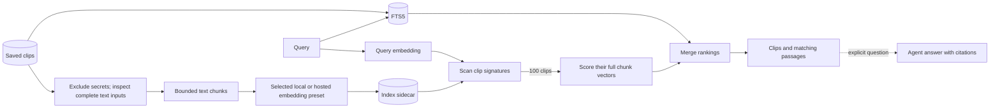
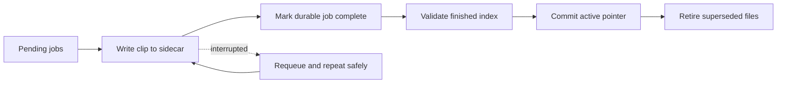

# Meaning Search and Recall

| Tool           | What it does                                                        | Needs a model?         |
| -------------- | ------------------------------------------------------------------- | ---------------------- |
| Keyword search | Finds words, prefixes, identifiers, paths, and code using FTS5      | No                     |
| Meaning Search | Finds related wording using text embeddings                         | Named embedding preset |
| Recall         | Answers an explicit question using retrieved passages and citations | Named chat preset |

An **embedding** is a list of numbers representing text meaning. Similar vectors
suggest related text. A **generation model** writes an answer. An **index
generation** is a version of the search index, not an AI-written answer.
A **sidecar** is a separate, rebuildable database file beside the main database.

Original clips remain usable if models or indexes fail. Capture never waits for
embeddings. The 60,000-clip capacity target still requires installed-platform
qualification; it is not a certified product claim.

While search results refresh, the search bar shows a fading blue-to-violet beam
following its rounded border. The previous results remain visible and temporarily
inert until replacement succeeds. The beam stops on completion or failure;
reduced-motion preferences replace its movement with a static border.

## Data flow



| Storage                               | Owns                                                         | Why                                             |
| ------------------------------------- | ------------------------------------------------------------ | ----------------------------------------------- |
| `clips.db`                            | Clips, FTS, model-space identity, jobs, active-index pointer | Canonical eligibility and durable coordination  |
| `search-index/generation-{id}.sqlite` | Chunks, snippets, provenance, vectors, routing signatures    | Disposable search payload; independent recovery |

A model space fixes provider/model revision, dimensions, normalization, distance
metric, and chunking compatibility. Vectors from different spaces never mix.
Shared Rust AI infrastructure resolves named connections and credentials for
search, Recall, and extensions. Feature code chooses its assigned preset;
provider adapters own protocol details and curated failures.

## Index construction

Inputs: notes, tags, every ready text representation, and completed OCR.
Equivalent visible text is embedded once, preferring the richest safely parsed
source; distinct representations remain searchable.

Semantic indexing excludes secret- and private-faceted clips for every provider, including
local Ollama. Before chunking or provider access, the host also scans complete
text inputs (including notes and existing OCR) with its deterministic secret
classifier; a match excludes the whole clip. The classifier favors precision: it
requires credential evidence (provider-specific key formats, private-key blocks,
credentialed URLs, `Authorization` headers, or credential-named assignments with
literal values) and never treats entropy or string shape alone, such as hashes,
IDs or an unlabeled JWT, as a secret. It is not a guarantee that every secret is
recognized. History and local FTS retain their normal access.
The same Rust eligibility predicate restricts semantic retrieval and assistant
access. New secret facets queue durable vector cleanup. Schema 26 also queues
existing indexed clips for cleanup and eligibility review; pending cleanup IDs
cannot supply semantic matches. This rebuilds derived data without resetting the
database or deleting originals.

| Format           | Chunk boundaries / extra context used only for embedding                            |
| ---------------- | ----------------------------------------------------------------------------------- |
| HTML / Markdown  | Headings, paragraphs, lists, quotes, code, table rows; heading ancestry and headers |
| JSON             | Object subtrees, array ranges; JSON Pointer paths                                   |
| CSV / TSV        | Whole rows with repeated headers                                                    |
| RTF              | Safely extracted paragraphs; reject unsafe control content                          |
| Code             | Declarations and blank lines; inferred language                                     |
| OCR / plain text | Paragraphs, lines, Unicode-safe windows                                             |
| Notes / tags     | Separate labelled chunks                                                            |

| Budget                    | Limit                                                                 |
| ------------------------- | --------------------------------------------------------------------- |
| Packing target            | 1,536 UTF-8 bytes                                                     |
| Final embedding input     | 2,048 bytes                                                           |
| Provider batch            | At most 16 inputs                                                     |
| Structural context        | 384 bytes                                                             |
| Oversized-atom overlap    | At most 256 bytes                                                     |
| Chunks per clip           | 64                                                                    |
| Reserved note/tag chunks  | Up to 8                                                               |
| Truncated clip            | Sample across content; reserve final slot for bounded routing summary |
| Provider context overflow | Subdivide only that chunk; bounded retries                            |

Hash complete enriched inputs and embed duplicates once per generation.
Display snippets remain clean; structural embedding context does not become
canonical content.

Embedding configuration exposes dimensions, query/document task policy, and
explicit hosted-indexing consent. Chat context/output settings do not apply.
Discovery supplies application bounds and known protocol options; custom model
support remains unverified until the provider accepts the probe. Typed, definite
context rejections permit bounded subdivision; authentication and quota failures
are never treated as a reason to split or truncate input.

## Retrieval and ranking

```text
Scope/tags/format/facet filters in canonical SQLite
  -> eligible IDs + update times -> sidecar ordinals -> compact eligibility bitset
  -> embed query in active space
  -> parallel scan of eligible clip signatures
  -> best 100 clips
  -> exact float32 scoring of every chunk in those clips
  -> best chunk per clip
  -> optional semantic similarity floor
  -> combine with keyword results -> stable cursor pages
```

Each clip signature is the bitwise majority of its normalized chunk-vector signs.
It selects candidates only; exact vector scoring supplies final similarity.
This keeps routing small and maintainable, but can miss relevant clips outside
the shortlist. Measure retrieval quality before changing the candidate budget.

Keyword and semantic ranks merge by clip ID using equal-weight reciprocal-rank
fusion, `k = 60`. Stable score/time/ID ordering makes pagination deterministic.
A semantic failure leaves keyword results available with diagnostics.

The displayed percentage is rounded cosine similarity, not confidence or a
probability. The optional device-local minimum applies only to semantic
candidates, defaults off, needs no reindex, and resets when model space changes.
FTS matches are never filtered by it.

## Index lifecycle and recovery



Exactly one validated generation is active per semantic source. Sidecar writes
precede job completion; per-clip replacement is safe to repeat.

Each space retains a nonsecret provider binding: its connection, model and
embedding options. Queries use the active space's binding while a replacement
builds. Credentials remain live protected references; removing/disabling the
saved configuration or changing its endpoint/organization makes that binding
unavailable, rather than sending a current key to a retired destination. A
retained-source query failure is reported with that search and never marks the
replacement provider unhealthy. Older unbound spaces accept the current route
only after full descriptor verification; otherwise keyword search remains usable.

| Operation / failure                            | Behaviour                                                                                                                    |
| ---------------------------------------------- | ---------------------------------------------------------------------------------------------------------------------------- |
| Replacement generation built beside active one | Existing generation can serve searches until validated replacement activates                                                 |
| Reindex All                                    | Check disk and provider, then discard text spaces/indexes/jobs and build fresh; old semantic index does not remain available |
| Clear-space command                            | Same provider-validated full reset; enqueues fresh work                                                                      |
| Provider validation fails before reset         | Preserve existing index                                                                                                      |
| Ollama digest changes behind the same model ID | Stop indexing and semantic queries with a rebuild diagnostic; preserve FTS and captured clips                                 |
| Interrupted running job                        | Requeue; existing valid sidecar write may be repeated                                                                        |
| Finished sidecar, activation interrupted       | Validate and activate without rebuilding                                                                                     |
| Missing/corrupt building sidecar               | Reset durable jobs to pending before replacing file                                                                          |
| Ordinary clip edit                             | Update only that clip; clear old checkpoint checksum before write                                                            |
| Clip deletion                                  | Canonical deletion succeeds; eligibility hides stale rows; durable cleanup removes retained-index references                 |
| Factory reset                                  | Remove the owned search-index directory with other reset data                                                                |

**Replacement and explicit reset differ.** The reset clears text embedding
spaces, generations, jobs, cleanup intents, and sidecars; preserves clips, FTS,
and provider configuration; recreates the model space; and queues eligible clips.
Meaning Search waits for the new index. Reindex checks estimated replacement
space plus a 64 MiB reserve before starting.

SQLite transactions, WAL recovery, schema identity, integrity checks, and bounded
checkpoints protect active sidecars. Resetting job state before replacing a broken
building file prevents a second crash from activating an empty index with stale
"completed" jobs.

Deletion cleanup is durable and idempotent. The single search worker removes a
deleted clip from every retained active, building, or failed sidecar, deleting
chunks before their clip row and then collecting unreferenced vector inputs.
Superseded sidecars are disposable and are not cleanup targets. Cleanup failures
remain visible as degraded status, but do not prevent independent pending clips
from being indexed; cleanup also continues while embedding is disabled.

Embedding-space rows own vector dimensions. Generation rows explicitly record
the sidecar backend, vector encoding, and candidate policy used to create them;
these values have no schema defaults, so runtime creation cannot silently inherit
an obsolete storage format.

Ollama's saved digest is verified against the installed tag before and after
each embedding request. Results are discarded if the tag changed during the
request. Reindex explicitly probes and accepts the replacement revision. Hosted
identity binds endpoint, model ID, dimensions, task policy and preprocessing;
unreported provider weight changes cannot be detected. Rotating credentials alone
does not change the space. Recall refreshes search readiness on provider, space,
search-source, and AI-configuration events.

## Storage and trade-offs

Each sidecar contains clean snippets/provenance, stable clip/chunk ordinals,
deduplicated normalized float32 vectors, one binary signature per clip, and
routing pages of at most 256 clips. The main database records its safe relative
path, state, space, backend/encoding, candidate policy, size, and optional checksum.

| Design                                  | Benefit                                                     | Cost                                                       |
| --------------------------------------- | ----------------------------------------------------------- | ---------------------------------------------------------- |
| Mandatory FTS + optional Meaning Search | Exact lookup survives model failure                         | Merge two rankings                                         |
| Generation sidecars                     | Validate before activation; disposable derived files        | Parallel replacement may need two indexes on disk          |
| Binary routing + exact rerank           | Compact first scan; no graph/server/native index dependency | Shortlist can miss a relevant clip                         |
| Structured chunks + per-clip budget     | Preserve context and bound work                             | Long clips lose semantic detail; original remains complete |
| Explicit Recall                         | User controls when generation runs                          | Answers need source verification                           |

At 1,024 dimensions:

```text
One float32 vector       = 1,024 × 4 bytes = 4 KiB
540,000 vectors          ≈ 2.06 GiB before snippets/mappings/SQLite overhead
60,000 binary signatures ≈ 7.3 MiB before page overhead
```

The mixed 60,000-clip fixture yields 77,900 chunks, with 71,901 unique inputs
(319,078,400 raw vector bytes at 1,024 dimensions; chunk-count p50 1,
p95/p99/max 3). It is synthetic, not a prediction of user storage. The larger
540,000-vector case tests capacity. Model dimensions, text lengths, duplication,
OCR, and separate binary payloads determine real disk use. Intelligence reports
actual active bytes and estimates replacement space from the existing index.

## Recall

Models supports explicit removal of saved presets and provider connections with
an inline impact confirmation. Assigned features become None; removing active
embeddings disables new indexing without removing clipboard content or FTS.
Saved chats retain their transcript and clear removed model selections. Provider
removal includes its model configurations and retryable protected credential
cleanup. JSON import remains a stable-ID merge and never deletes omitted records.

Intelligence → Models is the common configuration workspace. Its active-model summary assigns independent named presets to Recall, semantic search, and extension generation, plus independent privacy and general decision presets, a reserved rerank preset and an optional Tavily connection. The overview places the active-model summary in an inset card above a saved-configuration list. Provider and model configuration replace the overview with a dedicated view and a Back action. The overview links to the setup guide. Provider editors can test unsaved Ollama, OpenAI, Claude, Gemini, and OpenRouter settings without persisting them. Tests check catalog access rather than model execution; editing the draft clears its result. Saved credentials are reused only for the same provider and normalized endpoint; a changed endpoint requires an explicitly entered key. Add model discovers the connection catalog and filters a searchable picker by use; typing inside the picker filters the discovered list locally. Ollama reports embedding, completion, and decision capability; Gemini reports supported methods; Claude models use chat; OpenRouter requests all output modalities so text, embeddings, decisions, and rerank models appear with their reported purposes. OpenAI known model-family classifications are labelled inferred. Unknown capabilities require an explicit picker option, and manual IDs remain an explicit fallback. Import/export use an inline view and advanced options remain collapsed. JSON file import/export and read-only validation previews follow the [configuration contract](MODELS.md#named-ai-configurations).

Ollama decision presets use the [System One API](https://github.com/ollama/ollama/blob/main/docs/capabilities/decision.mdx). An explicit test sends a fixed synthetic classification input, validates the returned choice and probabilities, and never reads clipboard data. Confidence measures preference among labels rather than correctness. OpenRouter decision presets use its Decisions API; rerank execution remains reserved. Intelligence → Decision rules configures optional contextual privacy checks, pre-storage secret exclusion, and custom text rules. Privacy is evaluated before general rules (tags, favorites, and pins), indexing, or automatic extension disclosure. General rule actions only add metadata and never remove existing favorites or pins. Both decision assignments may reference the same preset. Selecting a privacy model enables checks on new captures and sends text to its configured provider, including hosted providers. A local Ollama endpoint is not proof of on-device execution because it can route cloud models. Checks never automatically fall back to another provider. Rule testing sends only the supplied sample and does not save it or apply actions. True means yes to the rule’s question; False means no. A yes probability of at least 50% matches the rule. These probabilities describe the model’s estimated answer, not its correctness; a non-match does not establish that a clip is safe.

Recall is a separate, lazily loaded workspace. History remains the startup page. History's Ask action and shortcut open Recall with the current query and filters and explicitly submit one turn; reopening the workspace does not replay that submission. Search input alone never starts generation. Saved conversations, source snapshots, and interrupted-run recovery follow the [data model](MODELS.md).

### Native SDK transport

The separate Recall runtime modules use pinned AI SDK provider adapters and an
assistant-ui custom model adapter in the existing webview. OpenAI uses Responses;
Anthropic and Gemini use their native adapters; OpenRouter uses its maintained
adapter; Ollama uses OpenAI-compatible chat completions. These modules are not
loaded by History startup. The Recall workspace uses the selected named chat preset.

The preset context limit bounds the messages ClipsX sends; it does not configure
Ollama's runtime context allocation. Ollama's OpenAI-compatible endpoint uses the
model's configured context size. Configure a model with `PARAMETER num_ctx` in a
Modelfile when a different allocation is needed, and keep the ClipsX budget within
that model's actual context capacity. Large context allocations increase memory
requirements; reasoning and CPU inference can also make multi-step turns slow.
See [Ollama context configuration](https://github.com/ollama/ollama/blob/main/docs/api/openai-compatibility.mdx#setting-the-local-context-size).

Rust binds a request to a host-resolved run and saved provider destination. The
renderer receives a transport placeholder rather than a credential. Rust checks
origin, provider API path, method, query parameters, and headers before injecting
authentication. Remote endpoints require HTTPS; only loopback Ollama permits
HTTP. Redirects are rejected, and provider failure bodies are not forwarded.

Requests are bounded to 8 MiB, responses to 32 MiB, and concurrent requests to two.
Ordered Tauri events carry response headers, chunks of at most 64 KiB, and one
terminal outcome. The host waits for each chunk's consumption acknowledgement;
Stop cancels a pending request, including a cancellation during startup. No Node
or Bun process is part of the application runtime.

The opt-in `recall-runtime-probe` build feature runs synthetic provider responses
in a hidden production webview without opening application storage or telemetry.
It is a verification tool, not a live-provider capability test. Build with
`CLIPSX_RECALL_RUNTIME_PROBE=1` and
`npx tauri build --no-bundle --features recall-runtime-probe`, then run
`npm run test:recall-runtime`. The report records provider tool/image round trips,
tool-free non-streaming context requests through the same authenticated bridge,
native authentication receipts, cancellation, and the actual webview user agent.
Normal builds omit the fixture HTML entry and reject probe command-line flags
before application initialization. Live provider/model support must be
verified separately with configured credentials.

The same opt-in build includes an isolated native acceptance runner. Run
`node scripts/verify-recall-acceptance.mjs <installed-tool-capable-Ollama-model>`
to exercise the production TypeScript adapter, authenticated Rust transport,
clipboard tools, conversation persistence, image snapshots, and a second-process
restart. It uses synthetic clips in a fresh marked temporary directory, never the
ordinary clipboard profile, capture, or telemetry. Reports identify the actual
model and webview. This runner does not certify the visible desktop UI or hosted
providers.

Pass `--thinking-off` after the model ID to test the normal validated reasoning
override on a model that advertises support for disabling thinking. Unsupported
overrides fail rather than bypassing capability checks. The acceptance runner
requires a grounded citation, rejects unsupported numeric local references, and checks organization state before and after Undo.

Both probe scripts accept `CLIPSX_RECALL_PROBE_BINARY` to select an opt-in
executable outside the default release path. This permits testing a separate
binary while the ordinary desktop app remains running.

### Assistant clipboard operations

The Rust `ClipboardService` owns version 1 assistant read contracts. Its Tauri
adapters expose status, filters, keyword/hybrid search, text pages, and verified
image previews. Both the Recall workspace and external MCP clients use these
contracts. Assistant access excludes `core.security.secret` clips; ordinary
History keeps its existing access policy. Eligibility is checked again when a
clip or image is read, including direct access by ID.

Assistant tool input schemas inline nested types, including source references,
filters, revision tokens, and format enums. Both transports publish the same
generated contracts without relying on provider support for JSON Schema `$ref`.
Rust remains authoritative for argument validation and mutation admission.

Capture-time ranges, source application IDs, and excluded clip IDs participate
in the shared SQL predicate before keyword and semantic candidate selection.
Search defaults to keyword retrieval, 20 results, and a maximum of 50. An empty
assistant query browses recent eligible clips. Hybrid failures retain keyword
results; source outcomes and typed warnings describe unavailable or incomplete
retrieval. Semantic shortlist results are approximate. Ranking scores are not
confidence estimates. Cursors bind to filters and assistant eligibility.

Text pages default to 8 KiB and cannot exceed 32 KiB. Captured text, notes, and
existing OCR are separate inputs; pending OCR is reported without starting or
waiting for work. Continuation cursors bind to the clip revision, selected
representation, content kind, and text fingerprint, and preserve UTF-8 boundaries.
Revisions include captured identity and organization state; copying/access counts
do not invalidate them.

Image reads accept clip and representation IDs only. PNG/JPEG previews verify
managed-file ownership and hash before decoding with a 64 MiB allocation limit.
The longest returned edge is at most 2,048 pixels; base64 payloads are at most
4 MiB. Results include source fingerprints, original/returned dimensions, and
resizing status. Search includes representation descriptors rather than image
bytes. File-list descriptors grant no access to referenced files.

Rust DTOs derive TypeScript with `ts-rs` and JSON schemas with `schemars`.
`generated_contracts_match` verifies checked-in declarations during native tests.
Set `CLIPSX_GENERATE_CONTRACTS=1` and run that test to regenerate them. Formatting
excludes the generated file so CI can compare its declarations deterministically.

## Qualification

Run ignored scale tests in release mode using the application binary target:

```sh
cargo test --release --manifest-path src-tauri/Cargo.toml --bin clipsx semantic_scale_qualification -- --ignored --nocapture
cargo test --release --manifest-path src-tauri/Cargo.toml --bin clipsx packed_sqlite_scale_qualification -- --ignored --nocapture
cargo test --release --manifest-path src-tauri/Cargo.toml --bin clipsx history_search_scale_qualification -- --ignored --nocapture
```

| Test                 | Scope / gate                                                                                              |
| -------------------- | --------------------------------------------------------------------------------------------------------- |
| Semantic corpus      | Structure, bounded chunks, deduplication, 60,000 synthetic clips                                          |
| Paged binary routing | 60,000 clips / 540,000 chunks; 21 runs; p95 at most 125 ms on qualification host                          |
| History / FTS        | First/deep 50-item pages, selective/common search, batched hydration; p95 100 ms history / 250 ms keyword |

These are test gates, not current release measurements. Retain actual output with
the tested revision and machine in [release evidence](../.agents/skills/clipsx-release/references/operations.md#evidence-and-sign-off).
There is one production retrieval backend; full-scan oracles and fixtures are
test tools.

Before advertising 60,000 clips, certify labelled recall@10/@50 with filters and
long documents, query/rebuild latency, peak memory, steady/rebuild disk,
capture responsiveness during indexing, and interrupted/missing/corrupt-index
recovery on each advertised platform.


## Keyword search and request lifecycle

| Capability                        | Current implementation                                                   |
| --------------------------------- | ------------------------------------------------------------------------ |
| Keyword search                    | Always-available FTS5; exact words/prefixes                              |
| Meaning Search                    | Optional Ollama or explicitly enabled hosted text embeddings                                         |
| Recall                            | Explicit chat with a named provider preset and shared clipboard tools |
| OCR                               | Native platform providers above                                          |
| Hosted text embeddings            | Native OpenAI, OpenRouter, and Gemini adapters; credentials and opt-in required                                                       |
| Ollama network                    | Loopback endpoints only                                                  |

One derived FTS document per clip combines notes, tags, ready text, and completed
OCR. HTML/RTF contribute safe visible text; equivalent normalized inputs
contribute once. Simple queries use whitespace-separated prefix terms with
implicit AND; advanced queries use FTS5 syntax with typed errors.

Keyword/filter eligibility runs in SQLite. Optional sources use the same
eligible clips and may add semantic-only matches. Each source returns at most
5,000 candidates; FTS snippets are bounded in SQLite. Source failures preserve
successful results. Ranking, semantic limits, index recovery, and Recall are
defined in the retrieval, index lifecycle and Recall sections above.

Search participation and embedding/indexing enablement are separate settings:
excluding Meaning Search from a query does not itself stop indexing.

```text
Query/filter change -> invalidate old responses immediately
  -> retain old rows + preview with "updating" state
  -> pause result actions/pagination; hide native extension detail surface
  -> keyword success: atomically replace rows and keyword cursor
  -> semantic enrichment: append deduplicated semantic-only matches
     keyword failure: keep stale rows and offer retry
     semantic failure: retain usable keyword rows and report its source outcome
```

History schedules keyword retrieval after 75 ms of inactivity. When Meaning Search is enabled, a separate hybrid request enriches the first keyword page at or after 250 ms, without delaying usable keyword results. Keyword pagination retains its own cursor and inserts additional keyword rows before Related matches; semantic enrichment is bounded to its first 50 candidates. Both paths share the native search engine and filters. Superseded requests and unmounted input controllers cannot publish enrichment. IME composition pauses retrieval.

Only pages from the current request may append. Selection survives by ID where
possible and clears on empty results. Input remains editable; operations already
started, including note saves, may finish. Status events are coalesced to one
start per 500 ms, one active refresh, and one trailing refresh; unmounted
consumers ignore late responses.

Models is the default Intelligence section; its shared configuration workspace is described under Recall above. Bounded Ollama model inspection derives `embedding` /
`completion` capabilities. Indexing owns progress, failures, retry, reindex,
disk use, and reset. Extensions receive provider availability and output, never
endpoint/model configuration or credentials.

Contextual help uses the current app language and the existing external-browser
command. Models links to the shared Local AI guide and its embedding/generation
sections; Recall links to its task guide. Recall remains available for retrieval without a chat preset and offers configuration guidance for chat. Browser failures
offer a localized manual URL and do not alter provider configuration or clips.

## Startup measurement

Use an isolated profile and a coherent database backup, with reporting and autostart disabled. Record source revision, OS/hardware, fixture size, cache state and warm-up separately. Compare repeated production launches without building during measurement.

`clipsx.first-history-paint` is a Performance API mark after two animation frames with nonempty history mounted; it is a paint proxy, not pixel detection. Distinguish process-launch from webview-navigation latency. Windows native process CPU samples exclude WebView2 child processes. Retain raw results with the measurement; one machine’s timings are not product guarantees.

## Intelligence workspace

Intelligence opens on Overview unless an explicit destination is supplied. Overview summarizes search indexing, native text recognition, model assignments, and enabled decision rules, with links to the owning configuration pages. A model assignment is not a provider health check. Local and hosted providers remain explicit user choices.

## Native embedding configuration

An inactive hosted embedding preset can be saved without credentials or indexing consent. Activating it requires both a protected credential and explicit hosted-indexing consent in the preset, including for free models. Missing consent or credentials produces an actionable configuration error and leaves the previous selection intact.

Background embedding jobs resolve the saved preset and protected credential in Rust, without mounting Recall or invoking the webview. Ollama retains its existing model-digest identity and preprocessing compatibility. OpenAI and OpenRouter use the text embeddings endpoint; Gemini uses bounded batchEmbedContents requests. Anthropic has no embedding adapter. Inputs and response vectors are bounded; vectors must have the expected count, order, finite values, nonzero norm, and verified dimensions. Hosted vectors are normalized locally.

A space identifies provider/model, endpoint, dimensions, preprocessing, normalization, and query/document task policy. Gemini taskType retrieval and embedding-2 retrieval prefixes are distinct policies. Hosted credentials and display names are excluded from identity. Replacement presets are probed for both query and document dimensions before configuration changes. The existing generation activation remains atomic; query/index operations refuse mismatched hosted space identities. Keyword results remain available while semantic retrieval is unavailable.

Configuration and protocol fixtures do not certify a live provider or model. See the [data model](MODELS.md#named-ai-configurations) for persistence, migration, import validation, and protected storage. Protocol references: [OpenAI embeddings](https://developers.openai.com/api/reference/resources/embeddings/methods/create), [OpenRouter embeddings](https://openrouter.ai/docs/api/api-reference/embeddings/create-embeddings), [Gemini embeddings](https://ai.google.dev/gemini-api/docs/embeddings).

## Internal agent runtime

The lazy TypeScript runtime uses one AI SDK tool loop, rendered through an assistant-ui custom adapter. OpenAI Responses, Anthropic, Gemini, OpenRouter, and Ollama chat use the authenticated Rust streaming bridge. Rust freezes the selected connection, preset, filters, attachments, and web setting per run; credentials remain in protected storage. One native run is admitted at a time. Provider requests have a ten-minute total bound and a two-minute read-idle timeout; actively streaming local reasoning is not cut off after two minutes. Incomplete replies distinguish cancellation, output limits, provider filtering, timeouts, and other request failures.

Each turn permits eight model steps and three clipboard search rounds. Refinement can narrow the frozen filters, never widen them. Reads have four concurrent slots; mutations are serialized and receive stable request IDs. The native model-facing schemas omit requestId because the adapter generates it; external MCP clients still supply their own stable IDs. Both transports classify malformed tool arguments as `invalid_parameters` without echoing their contents or recording a mutation; the native agent receives schema guidance for correcting them. Rejected reads provide valid text-kind choices and invite correction within the remaining step budget; failed reads never register citations. Unknown tool support is verified with a read-only status call before ordinary clipboard writes are enabled. This capability-only step receives a status instruction; the user's task and prior context are restored with the status result for the next step. Models configured without tool support provide ordinary chat. If an unknown-capability status probe is rejected before any output or tool call, the same model may retry once with all tools disabled. This turn is labelled ordinary chat; no capability claim is persisted. Undo remains available to the native agent when the user requests reversal; availability metadata is not a reversal instruction. The agent must not undo successful actions for cleanup or verification, and its final answer must reflect any later reversal. Stop cancels model requests and pending reads; admitted transactions finish and their committed actions remain undoable.

Provider-neutral conversation context preserves the latest question and labels clipboard evidence. A pure planner accounts for instructions, active tool schemas, messages and images using a conservative estimate. All model steps, including capability verification and ordinary-chat fallback, check the frozen input policy. Native text pages and candidate counts adapt to the next-step reserve. Older completed conversation is compacted with the current model and no tools or web; recorded action outcomes remain separate from summary prose. At most two compaction calls are permitted per turn. Failure stops clearly when the request cannot fit; transcripts remain saved. A definitive pre-stream context rejection permits one reduced request retry without restarting the agent or replaying tools. A ten-minute cumulative deadline includes compaction. Only verified managed image bytes become labelled inline image context; renderer messages never authorize downloading remote images. Length-limited and filtered responses remain incomplete.

Web access defaults off. Explicitly enabled turns use verified native provider search capabilities or the selected Tavily connection. Missing web configuration returns setup guidance without changing the chat provider. Tavily search and extraction have bounded calls and content; web citations remain separate from clipboard sources. Retrieved content is evidence, not instructions.

Runtime fixtures verify provider protocol translation, streaming, tool execution, and cancellation; they do not establish live model capability or platform availability.

## Recall workspace interaction

The sidebar Recall entry reopens the latest saved conversation. History Ask opens a fresh local draft with the current query and search scope prefilled; it never appends to an unrelated conversation or sends automatically. New chat also creates a local draft. The first submitted message initializes persistence once, including its selected model, reasoning and web settings; abandoned drafts do not create database rows. The agent chooses whether to search, read, refine, or act; ordinary chat and follow-ups do not require a retrieval step. Keyword search is its default clipboard search mode, with hybrid retrieval available when helpful. Search tool results appear as usable candidate cards before the final answer. Activity reports actual tool execution. Provider-returned reasoning or summaries appear separately in a collapsed section; absent reasoning is never fabricated.

The composer is Recall's only query input. Draft text schedules local keyword suggestions after 75 ms and hybrid enrichment after 250 ms when ready, pausing during IME composition and ignoring superseded responses. Empty drafts and active runs do not schedule suggestions. Draft suggestions never start generation or become model context automatically; users can attach selected clips explicitly, or attach up to three current top matches in one action. Attachments are visible before Send and use the same bounded, revision-validated text context even for models without tool support; this does not grant those models autonomous retrieval or actions. Send starts the existing agent loop, which remains free to search, refine, read, or answer directly. Recall's assistant eligibility policy continues to exclude secret-faceted clips.

A collapsible Context panel, open by default, shows clipboard evidence for the selected answer, agent search candidates grouped by their actual queries, and separate suggestions for the current draft. Context remains inline: beside the conversation when space permits, or below it on narrow layouts. A pointer- and keyboard-operated divider resizes it without unmounting chat. Search candidates remain distinct from read evidence. Reading a clip, attaching evidence that fits the context budget, and supported image reads allocate references; unavailable OCR and unsupported or omitted image input do not. Older answer selection and citations select that answer's evidence, with numbering scoped to its clip revisions. Completed answers validate local reference numbers against the run's inspected evidence. Missing or invalid references permit one answer-only repair with the same model, tools and web disabled, within the eight-model-step and cumulative deadline limits. Repair preserves tool receipts and committed operations; it never remaps an invented number to a source. A failed repair leaves the answer explicitly incomplete with source-validation guidance. Activity reports actual execution and committed writes, with guarded Undo.

Sources open the shared History clipboard preview renderer inside the Context panel, with header Back/Close controls. Recall preview visibility is independent of History search staleness, including native extension surfaces. Late preview loads are ignored after close, replacement, or conversation changes. Retained source snapshots remain readable when originals disappear; live reads appear before terminal persistence and saved image snapshots load on an explicit preview request. A missing original never removes a saved conversation.

Selection is keyed by clip ID and enrichment does not move keyboard focus. Copy and local suggestions remain available without a chat preset. Dismissal excludes a suggested clip only for its current query/filter context. Search scope filters constrain suggestions and subsequent agent tools. A compact composer toolbar contains a searchable model picker grouped by connection, reasoning controls, and optional web research. Configuration, conversation switching, and attachment changes are disabled during runs. Conversation reasoning overrides are saved locally and reset on model changes; Default leaves the shared preset unchanged. Chat deletion explicitly explains its independent retention.

### Reasoning controls

The main-webview-only `assistant_model_options` command resolves controls for a saved chat preset. Ollama uses bounded `/api/show` thinking metadata; missing metadata does not imply selectable levels. OpenRouter uses model reasoning metadata intersected with the installed adapter's supported vocabulary, excluding disable choices for mandatory reasoning. OpenAI, Anthropic, and Gemini use conservative documented model families. Unknown models retain preset defaults. Discovery results are bounded and cached for five minutes, keyed by saved connection and preset configuration.

Rust validates explicit overrides before saving a thread and admitting a run. Defaults require no capability lookup on the generation path. The frozen run context retains the selected override independently of its preset. TypeScript translates that control into the selected provider's request options; SDK adapters own provider protocol details. OpenRouter Default uses the saved preset effort; a conversation effort or token budget overrides it. Thinking budgets offered in Recall stay below the resolved output allowance to leave answer room. The internal adapter streams returned reasoning into typed conversation parts, without introducing another tool loop or replaying reasoning text as instructions in provider-neutral history.

Capability metadata and documented families establish available controls, not a live inference test. Relevant contracts: [Ollama thinking](https://docs.ollama.com/capabilities/thinking), [OpenRouter reasoning](https://openrouter.ai/docs/guides/best-practices/reasoning-tokens), and AI SDK provider documentation for [OpenAI](https://ai-sdk.dev/providers/ai-sdk-providers/openai), [Anthropic](https://ai-sdk.dev/providers/ai-sdk-providers/anthropic), and [Google](https://ai-sdk.dev/providers/ai-sdk-providers/google).

### Resolved model limits

Auto uses the smallest known model/runtime shared-context limit, or a reported independent input limit when no shared window is known. Unknown capacity uses the preset's editable fallback (new presets default to 131,072 context and 8,192 output), uniformly across providers. An unknown runtime allocation does not discard advertised model capacity; its capacity remains labelled unverified. Auto output is capped at 8,192 tokens, one quarter of capacity, and known provider output limits; when capacity is unknown, the saved output fallback is an additional cap. Explicit limits remain stored and are bounded by known restrictions. Shared windows reserve output space before applying any independent input bound; separate input/output windows do not subtract output from input. Incompatible explicit output limits are rejected rather than silently rewritten. Byte-based accounting and fixed image allowances are conservative estimates, not exact tokenizer guarantees. Instructions and tool-schema overhead that cannot fit is a request-context failure, not an oversized-question failure. Provider usage from generation and compaction is retained for comparison; the Ollama compatibility adapter explicitly requests streaming usage reports. Missing provider usage remains unknown. Recorded action receipts are reconciled against recent durable activity outside generated summaries; historical receipts do not establish current clip presence. Intelligence Models keeps exact overrides in Advanced and reasoning controls remain model-specific. Provider observations and summaries are omitted from configuration JSON version 4; versions 1, 2, and 3 remain importable.

Official OpenAI GPT-4.1 and supported GPT-4o snapshot limits use reviewed rules v1 (2026-10-12) when API metadata is incomplete, based on the [GPT-4.1](https://developers.openai.com/api/docs/models/gpt-4.1) and [GPT-4o](https://developers.openai.com/api/docs/models/gpt-4o) specifications. These rules never apply to custom endpoints. Unrecognized model IDs retain unverified fallback limits. Anthropic reported image, structured-output, and thinking capabilities remain separate from client-tool support.

### Initial evidence from History

Submitting History's Recall action starts a fresh chat and prepares bounded clipboard evidence before model generation, independently of tool support. Application retrieval uses the shared Rust search/read operations with the frozen filters and secret exclusion. It tries keyword search, then hybrid only when keyword search has no candidates and semantic search is ready. At most three candidates are read; explicit attachments take priority and automatic evidence is bounded by the estimated input budget. These searches count toward the run's three-search allowance.

Automatic sources use the existing citation registry and verified conversation snapshots. The context panel labels application retrieval separately from model tool calls; no synthetic tool calls are added to the transcript. Retrieval failures and insufficient budget do not prevent ordinary generation, and absent or incomplete evidence is supplied as an explicit outcome. Tool-capable models can refine retrieval within the remaining allowance. Ordinary chat submissions and later follow-ups do not automatically retrieve through this entry path.
